# Science Blocks: Industrial Planetary Ball Mill Simulation & Multiphysics Engine

> **Agent Guidance & Architecture Manual**  
> Definitive architecture reference, design conventions, and developer manual for AI agents and human contributors working on the **Science Blocks** Blender add-on.

---

## 1. System Overview & Core Capabilities

**Science Blocks** is an industrial-grade simulation and multiphysics add-on for Blender (4.0+) engineered for materials scientists, mechanical engineers, and process researchers. The system bridges rigorous mathematical mechanics with high-fidelity scientific 3D visualization:

1. **Kinematic Transmission Node System (`ScienceBlocksTree`)**:
   - Custom Blender node system modeling sun-wheel carrier discs, counter-rotating milling jars, gear ratios, planetary transmission, and rotational velocity propagation.
   - Frame-by-frame forward kinematics handler (`@persistent evaluate_kinematics_frame`) evaluating analytical rotational expressions in real time.
2. **Industrial DEM Physics Simulation Engine**:
   - In-viewport Discrete Element Method (DEM) particle solver based on Hertz-Mindlin contact mechanics, Mindlin-Deresiewicz rolling friction, restitution, and collision energy telemetry.
   - Particle-particle and particle-wall contact resolution, kinetic energy dissipation tracking, and trajectory keyframing.
3. **Chamber Surface Collision & Wear Heatmap (Static & Dynamic)**:
   - **Static Surface Impact Map**: Generates wear density, hit frequency, normal force, and momentum transfer heatmaps on jar chamber surfaces using 3D KD-Tree Gaussian splatting.
   - **Realtime 3D Animated Live Chamber Collision Visualizer**: Frame-synced live visualizer displaying active collisions, spatial proximity, and exponential afterglow trails during playback.
   - **Custom Publication Shaders**: Dual-pass Principled BSDF shader architecture featuring a semi-transparent chamber wall ($0.30$ base opacity) for internal ball visibility with vibrant, $1.00$ fully opaque, glowing emissive collision hot-spots.
4. **Hybrid Compute Execution**:
   - **Blender Python**: Bundled embedded runtime with automated dependency management.
   - **Local External Environment**: Virtualenv / system Python with asynchronous subprocess management.
   - **Google Colab Cloud GPU Bridge**: Asynchronous FastAPI client secured by native OAuth 2.0 PKCE authentication.

---

## 2. Decoupled Model-View-Controller Architecture

The add-on enforces strict separation of concerns across View, Model, Controller, and Physics Engine layers:

```mermaid
flowchart TD
    subgraph View ["1. VIEW (User Interface & Shaders)"]
        UI["ui_panels.py: Sidebar Tabs & Workflow Steps"]
        GA_UI["google_auth.py: OAuth Authentication Card"]
        MAT_HEATMAP["operators.py: SB_Chamber_Heatmap_Material"]
        MAT_LIVE["operators.py: SB_Live_Chamber_Collision_Material"]
    end

    subgraph Model ["2. MODEL (State, Cache & RNA Schemas)"]
        PROPS["properties.py: ScienceBlocksProperties"]
        GA_PROPS["google_auth.py: GoogleAuthProperties"]
        CACHE["dem_solver.py: DEMResult & Persistent Session Cache"]
    end

    subgraph Controller ["3. CONTROLLER (Operators & Handlers)"]
        OPS["operators.py: 45+ Operators (Bake, Setup, Live Visualizer)"]
        GA_OPS["google_auth.py: PKCE Loopback Server"]
        FRAME_HANDLER["operators.py: update_live_chamber_collision_frame"]
        SAVE_LOAD_HANDLER["operators.py: on_blend_save_or_load"]
    end

    subgraph Engine ["4. ENGINE (Kinematics & Multiphysics)"]
        NODES["nodes.py: ScienceBlocksTree & Kinematic Evaluator"]
        DEM["dem_solver.py: Vectorized Hertz-Mindlin DEM Engine"]
        COLOR["colormaps.py: Scientific Palettes (Viridis, Turbo, Plasma)"]
    end

    UI --> |Reads/Modifies| PROPS
    GA_UI --> |Reads/Modifies| GA_PROPS
    UI --> |Triggers| OPS
    GA_UI --> |Triggers| GA_OPS

    OPS --> |Updates State| PROPS
    OPS --> |Populates/Restores| CACHE
    OPS --> |Builds Node Trees| NODES
    OPS --> |Executes Physics| DEM
    OPS --> |Constructs/Assigns| MAT_HEATMAP
    OPS --> |Constructs/Assigns| MAT_LIVE

    FRAME_HANDLER --> |Reads Live Media & Hits| CACHE
    FRAME_HANDLER --> |Evaluates World KD-Tree| COLOR
    FRAME_HANDLER --> |Writes Color Attributes| BlenderScene["Active Blender 3D Scene"]

    NODES --> |Kinematic Rotation Feeds| BlenderScene
    DEM --> |Baked Coordinate Keyframes| BlenderScene
    SAVE_LOAD_HANDLER --> |Serializes/Deserializes| CACHE
```



---

## 3. Codebase File Map & Module Boundaries

| File | Primary Responsibilities | Key Symbols / Entry Points |
| :--- | :--- | :--- |
| [`__init__.py`](file:///home/vnews/Projects/Research%20project/Science_Blocks/__init__.py) | Extension metadata (`bl_info`), add-on lifecycle registration kickoff. | `bl_info`, `register()`, `unregister()` |
| [`auto_load.py`](file:///home/vnews/Projects/Research%20project/Science_Blocks/auto_load.py) | Dynamic module discovery, dependency inspection, topologically sorted RNA registration. | `init()`, `register()`, `unregister()` |
| [`properties.py`](file:///home/vnews/Projects/Research%20project/Science_Blocks/properties.py) | Global application state attached to `context.scene.science_blocks_props`. Node-panel synchronization logic. | [`ScienceBlocksProperties`](file:///home/vnews/Projects/Research%20project/Science_Blocks/properties.py#L30), `_sync_output_nodes_from_panel()` |
| [`ui_panels.py`](file:///home/vnews/Projects/Research%20project/Science_Blocks/ui_panels.py) | 3D Viewport sidebar panels (`N` key, tab: *Science Blocks*). Guided 4-step research workflow, live visualizer controls. | [`SCIENCE_BLOCKS_PT_main_panel`](file:///home/vnews/Projects/Research%20project/Science_Blocks/ui_panels.py), `SCIENCE_BLOCKS_PT_chamber_heatmap` |
| [`nodes.py`](file:///home/vnews/Projects/Research%20project/Science_Blocks/nodes.py) | Custom node graph system (`ScienceBlocksTree`). RPM math expressions, transmission ratios, rotation solvers, DEM solvers. | [`ScienceBlocksTree`](file:///home/vnews/Projects/Research%20project/Science_Blocks/nodes.py#L12), `ScienceBlocksRPMNode`, `ScienceBlocksChamberHeatmapNode` |
| [`dem_solver.py`](file:///home/vnews/Projects/Research%20project/Science_Blocks/dem_solver.py) | Vectorized Hertz-Mindlin DEM physics engine, rolling friction, restitution, persistent cache serialization. | [`DEMResult`](file:///home/vnews/Projects/Research%20project/Science_Blocks/dem_solver.py#L40), `solve_dem()`, `get_or_restore_dem_result()` |
| [`operators.py`](file:///home/vnews/Projects/Research%20project/Science_Blocks/operators.py) | Command execution: simulation baking, wear heatmaps, live 3D collision visualizer, shaders, blend persistence. | `compute_and_apply_surface_impact_heatmap()`, `update_live_chamber_collision_frame()` |
| [`colormaps.py`](file:///home/vnews/Projects/Research%20project/Science_Blocks/colormaps.py) | Scientific colormaps (`TURBO`, `VIRIDIS`, `PLASMA`, `COOLWARM`, `RAINBOW`, `ENERGY`, `HEAT_FLAME`, `HOT_COLD`). | [`evaluate_scientific_colormap`](file:///home/vnews/Projects/Research%20project/Science_Blocks/colormaps.py#L20) |
| [`google_auth.py`](file:///home/vnews/Projects/Research%20project/Science_Blocks/google_auth.py) | Native desktop OAuth 2.0 loopback server with PKCE (RFC 7636 / RFC 8252) for Google Colab authentication. | [`GoogleAuthProperties`](file:///home/vnews/Projects/Research%20project/Science_Blocks/google_auth.py#L50), `OAuthLoopbackServer` |
| [`report_generator.py`](file:///home/vnews/Projects/Research%20project/Science_Blocks/report_generator.py) | Scientific export generator: IEEE/Nature tables, telemetry CSVs, and analytical collision distribution figures. | `generate_simulation_report()` |
| [`test_comprehensive_system.py`](file:///home/vnews/Projects/Research%20project/Science_Blocks/test_comprehensive_system.py) | Automated integration and regression test suite covering kinematics, DEM solver, wear mapping, and telemetry. | `run_all_tests()` |

---

## 4. Custom Node Graph System (`ScienceBlocksTree`)

The custom node tree (`nodes.py`) provides an intuitive visual programming interface for complex planetary milling transmission setups:

```
[3D Object Input] ─────> [Object Rotation (RPM)] ─────> [Yade DEM Solver] ─────> [Chamber Surface Impact Map]
(Mesh & Role: JAR)       (Drive RPM & Tilt)             (Particles & Jar)        (Heatmap Wear Analysis)
```

### Key Node Types

1. **`ScienceBlocksMeshInputNode` (3D Object Input)**:
   - Injects custom chamber meshes or planetary disc geometry into the graph.
   - Role configuration: `SUN_DISC`, `JAR`, `MEDIA`, `OBSTACLE`.
   - Propagates target mesh reference to downstream kinematic and physics nodes.
2. **`ScienceBlocksRPMNode` (Object Rotation)**:
   - Evaluates analytical RPM expressions (e.g. `450 * sin(t)` or constant RPM).
   - Validates expressions safely, handles unit conversions ($\text{RPM} \leftrightarrow \text{rad/s}$), and enforces machine safety clamping.
3. **`ScienceBlocksGearRatioNode` (Planetary Gear Ratio)**:
   - Calculates planetary transmission ratio $i = 1 + \frac{r_p}{r_s}$ with automatic counter-rotation phase flipping.
4. **`ScienceBlocksRotationNode` (Kinematic Rotation Solver)**:
   - Forward kinematics solver evaluating 3-axis rotation, tilt angles (vertical, horizontal, 90° incline), and Euler/Quaternion orientation feeds.
5. **`ScienceBlocksYadeSolverNode` (Yade DEM Solver Block)**:
   - Configures and runs DEM particle simulation taking chamber geometry, media spheres, and kinematic drive feeds.
6. **`ScienceBlocksChamberHeatmapNode` (Chamber Surface Impact Map)**:
   - Computes particle collision wear on custom chamber surfaces.
   - Configurable metric modes: `HITS`, `FREQUENCY`, `FORCE`, `INERTIA`.
   - Tunable Gaussian blur radius ($\text{mm}$), contrast exponent, color palette, and emission glow.
7. **`ScienceBlocksTelemetryNode`**:
   - Streams live kinetic energy, collision power, and angular velocity telemetry for real-time monitoring and graphing.

---

## 5. Chamber Collision & Wear Heatmap Systems

Science Blocks features two complementary chamber collision visualization workflows:

### A. Static Surface Impact Map (`bake_surface_impact_map`)
- **Purpose**: Publication-grade wear distribution and collision telemetry post-simulation.
- **Metric Modes**:
  - `HITS`: Raw impact count density per surface area.
  - `FREQUENCY`: Impacts per second based on simulation duration ($\text{Hz}$).
  - `FORCE`: Normal/shear contact force magnitude ($N$).
  - `INERTIA`: Momentum transfer / impulse ($N \cdot s$).
- **Algorithm**:
  1. Populates a 3D KD-Tree with chamber mesh vertices transformed into **world space** ($v_{\text{world}} = M_{\text{world}} \cdot v_{\text{co}}$).
  2. Evaluates DEM impact coordinates via Gaussian kernel splatting ($w \cdot \exp(-0.5 \cdot (d / \sigma)^2)$).
  3. Applies 98th-percentile contrast normalization to prevent single extreme impacts from washing out overall wear gradients.
  4. Evaluates scientific RGB colormaps and stores per-vertex colors in Blender 3.2+ `mesh.color_attributes` (`FLOAT_COLOR`, domain `POINT`).
  5. Assigns `SB_Chamber_Heatmap_Material` and updates all polygon material indices.
  6. Automatically replicates wear patterns to `Jar_Chamber_SideView` if present.

### B. Realtime 3D Animated Live Chamber Collision Visualizer (`apply_live_chamber_visualizer`)
- **Purpose**: Real-time interactive inspection during 3D viewport timeline playback.
- **Execution**: Registered on `bpy.app.handlers.frame_change_post` (`update_live_chamber_collision_frame`).
- **Dual-Source Proximity Detection**:
  - *Source A (DEM Events)*: Active time window around current frame time ($t_{\text{curr}} - t_{\text{impact}}$) with exponential decay $\tau$.
  - *Source B (Direct Proximity)*: Queries spatial distance between chamber wall vertices and live animated grinding media spheres (`DEM_Media_*`, `Ball_*`) using the chamber's KD-Tree.
- **Temporal Afterglow Decay**:
  $$\text{Accum}_{t} = \max\left(\text{Instantaneous}_{t},\; \text{Accum}_{t-1} \cdot \lambda_{\text{decay}}\right)$$
  Provides smooth, fluid visual collision trails with adjustable persistence (`live_chamber_decay`, default $0.75$).
- **Publication Shader Architecture (`SB_Live_Chamber_Collision_Material`)**:
  - **Base Opacity ($0.30$)**: Container wall is semi-transparent and see-through at rest so internal tumbling media balls remain clearly visible during simulation.
  - **Collision Opacity ($1.00$)**: Where impacts occur, opacity dynamically scales to $100\%$ opaque with vivid scientific colormapping and emissive PBR glow without washed-out transparency.
  - **Dynamic Parameter Syncing**: Adjusting UI sliders immediately updates live shader nodes (`Live_Opacity_Map`, `Live_Emission_Mix`, `Live_Glow_Mult`).

---

## 6. Critical Blender API Quirks & Non-Negotiable Rules

AI agents and developers modifying this codebase **must adhere to these rules**:

### 1. Polygon Material Assignment vs Active Material Index
- **Trap**: Setting `obj.active_material_index = slot_idx` ONLY changes the highlighted row in Blender's material UI list; **it does NOT reassign mesh polygons!**
- **Rule**: To ensure the material actually renders on the object in Material Preview and Rendered viewport modes, you **must iterate over all polygons**:
  ```python
  target_obj.active_material_index = slot_to_use
  if hasattr(target_obj.data, "polygons"):
      for p in target_obj.data.polygons:
          p.material_index = slot_to_use
  ```

### 2. World Space vs Local Mesh Coordinate Invariance
- **Trap**: In Blender, `vertex.co` is in local object space. If an object is scaled in Object Mode (e.g., `Cube` scaled down by $0.2$), `vertex.co` is unscaled while physics coordinates are in SI meters. Building a KD-tree on raw `v.co` results in **zero collision hits**.
- **Rule**: Always transform vertices into world space before spatial queries:
  ```python
  world_mat = target_obj.matrix_world if hasattr(target_obj, "matrix_world") else None
  v_world = world_mat @ v.co if world_mat is not None and hasattr(world_mat, "__matmul__") else v.co
  kd.insert(v_world, i)
  ```

### 3. Collection Property Deletion Safety
- **Trap**: Blender's `IDMaterials` collection (`obj.data.materials`) does NOT have a `.remove()` method. Calling `obj.data.materials.remove(...)` raises `AttributeError: bpy_prop_collection: attribute 'remove' not found`.
- **Rule**: Use `.pop(index=i)` or overwrite the slot:
  ```python
  if hasattr(obj.data.materials, "pop"):
      obj.data.materials.pop(index=m_idx)
  else:
      obj.data.materials[m_idx] = default_mat
  ```

### 4. RNA Enum Synchronization & Defensive Assignment
- **Trap**: If an operator or node passes an enum string (e.g. `'HEAT_FLAME'`) not declared in `properties.py`'s `EnumProperty`, Blender RNA immediately throws `TypeError: enum 'HEAT_FLAME' not found`.
- **Rule**: All enum palettes (`TURBO`, `VIRIDIS`, `PLASMA`, `COOLWARM`, `RAINBOW`, `ENERGY`, `HEAT_FLAME`, `HOT_COLD`, `STEEL`, `CERAMIC`, `TUNGSTEN`) must remain strictly synchronized across `properties.py`, `nodes.py`, and `operators.py`. Always wrap RNA enum assignments in `try...except`:
  ```python
  try:
      props.sci_media_palette = pal
  except Exception:
      pass
  ```

### 5. Color Attribute De-duplication
- **Trap**: Repeatedly adding color attributes creates duplicate layers (`SB_Surface_Impact.001`, `.002`), bloating `.blend` files and confusing shaders.
- **Rule**: Always prune duplicate attributes before adding a new one, and set both `active` and `active_color`:
  ```python
  for ca_item in list(mesh.color_attributes):
      if ca_item.name.startswith(attr_name + "."):
          mesh.color_attributes.remove(ca_item)
  ca = mesh.color_attributes.get(attr_name) or mesh.color_attributes.new(name=attr_name, type='FLOAT_COLOR', domain='POINT')
  mesh.color_attributes.active = ca
  mesh.color_attributes.active_color = ca
  ```

### 6. Defensive Property Access in UI
- **Trap**: Accessing dynamic properties via `if props.attribute:` in UI `draw()` methods will crash Blender's draw loop if the property was freshly added or if an older `.blend` file is loaded.
- **Rule**: Always use `getattr(props, "attribute", default)`:
  ```python
  if getattr(props, "show_live_chamber_collision", False):
      layout.prop(props, "live_chamber_base_opacity")
  ```

### 7. Thread Safety & Main-Thread Hand-Off
- **Trap**: Calling Blender API methods (`bpy.context`, `bpy.data`) from background threads (e.g. Google OAuth loopback or HTTP pings) corrupts Blender's internal C state.
- **Rule**: Schedule main-thread execution using `bpy.app.timers.register(callback)`.

### 8. Simulation Cache Persistence Across Session Save/Load
- **Rule**: DEM simulation results are serialized and preserved across `.blend` save/load via `bpy.app.handlers.save_post` and `load_post` (`on_blend_save_or_load`), enabling users to save their project, reopen Blender later, and immediately inspect wear heatmaps without re-running lengthy simulations.

---

## 7. Testing & Quality Verification

Run standard syntax and bytecode verification:
```bash
python3 -m py_compile *.py
```

Run comprehensive headless automated test suite:
```bash
blender -b -P test_comprehensive_system.py
```

### Headless Execution Safety
When running operators or shaders in headless mode (`blender -b`), GUI-dependent structures like `context.screen.areas` may be `None`. Always guard 3D Viewport shading modifications:
```python
if context and hasattr(context, "screen") and context.screen:
    for area in context.screen.areas:
        if area.type == "VIEW_3D":
            # modify shading safely
```
