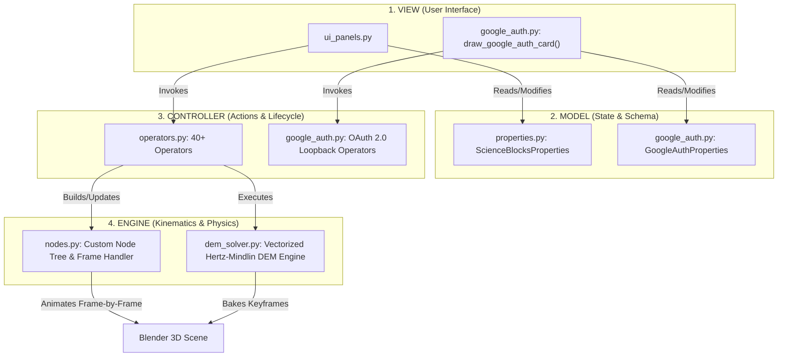

# Science Blocks: Industrial Planetary Ball Mill Simulation & Multiphysics Engine

> **Agent Guidance & Architecture Manual**  
> This file serves as the definitive architecture reference, conventions guide, and developer manual for AI agents and contributors working on the **Science Blocks** Blender add-on.

---

## 1. Project Overview

**Science Blocks** is a Blender (4.0+) add-on designed for researchers, materials scientists, and process engineers. It provides:
1. **Kinematic Transmission Node System**: Custom node tree (`ScienceBlocksTree`) modeling planetary gear ratios, sun-wheel carrier disc rotation, and jar counter-rotation with directional propagation.
2. **Industrial DEM Physics Simulation**: In-viewport Discrete Element Method (Hertz-Mindlin contact mechanics, rolling friction, restitution, and collision energy telemetry).
3. **Publication-Grade Scientific Visuals**: One-click Nature/IEEE-style publication shading, frosted glass shaders, alpha cutouts, technical cavity/AO viewport rendering.
4. **Hybrid Compute Execution**:
   - **Blender Python**: Bundled embedded runtime with automated pip installer.
   - **Local Environment**: External virtualenv / system Python with process tracking.
   - **Google Colab Cloud GPU**: FastAPI bridge connecting to remote Colab instances secured with Google OAuth 2.0 PKCE authentication.

---

## 2. Decoupled MVC Architecture

The codebase strictly separates responsibilities across modules:



---

## 3. Codebase File Map

| File | Purpose |
| :--- | :--- |
| [`__init__.py`](file:///home/vnews/Projects/Research%20project/Science_Blocks/__init__.py) | Add-on metadata (`bl_info`), initial registration kickoff. |
| [`auto_load.py`](file:///home/vnews/Projects/Research%20project/Science_Blocks/auto_load.py) | Dynamic module discovery and topologically sorted class registration. |
| [`properties.py`](file:///home/vnews/Projects/Research%20project/Science_Blocks/properties.py) | `ScienceBlocksProperties` definition attached to `scene.science_blocks_props`. |
| [`ui_panels.py`](file:///home/vnews/Projects/Research%20project/Science_Blocks/ui_panels.py) | 3D Viewport Sidebar panel ('N' key, tab: *Science Blocks*), guided workflow steps 1-4. |
| [`operators.py`](file:///home/vnews/Projects/Research%20project/Science_Blocks/operators.py) | Operator definitions: setup demos, DEM physics solver, side inspection view, environment management. |
| [`nodes.py`](file:///home/vnews/Projects/Research%20project/Science_Blocks/nodes.py) | Custom node classes (`ScienceBlocksRPMNode`, `ScienceBlocksGearRatioNode`, `ScienceBlocksRotationNode`) and `@persistent evaluate_kinematics_frame`. |
| [`dem_solver.py`](file:///home/vnews/Projects/Research%20project/Science_Blocks/dem_solver.py) | Vectorized DEM contact mechanics solver (Hertz-Mindlin, Mindlin-Deresiewicz, Euler integration). |
| [`google_auth.py`](file:///home/vnews/Projects/Research%20project/Science_Blocks/google_auth.py) | Native desktop OAuth 2.0 loopback listener with PKCE (RFC 7636 / RFC 8252) for Google Colab authentication. |
| [`colormaps.py`](file:///home/vnews/Projects/Research%20project/Science_Blocks/colormaps.py) | Scientific colormaps (Viridis, Plasma, Turbo, Jet) for particle velocity visualization. |
| [`test_comprehensive_system.py`](file:///home/vnews/Projects/Research%20project/Science_Blocks/test_comprehensive_system.py) | Automated test suites covering kinematics, 90° tilt, DEM solver, and telemetry exports. |

---

## 4. Key Engineering Guidelines for AI Agents

### 1. Defensive Property Access in UI
- **Never** access dynamic properties directly with `if props.attribute:` in UI draw functions.
- **Always** use `getattr(props, "attribute", default)` (e.g. `getattr(props, "dem_is_simulated", False)`).
- **Reason**: When Blender reloads scripts or opens an existing `.blend` file, in-memory RNA instances may lag behind source code changes. Defensive access guarantees Blender's UI draw loop never crashes.

### 2. Blender Class Registration Safety
- In `register()`, always unregister before re-registering to ensure Blender updates its internal C/RNA type registry:
  ```python
  def register():
      try:
          bpy.utils.unregister_class(MyClass)
      except Exception:
          pass
      bpy.utils.register_class(MyClass)
  ```

### 3. Thread Safety in Blender
- Background threads (such as the HTTP loopback server in `google_auth.py` or asynchronous pings in `operators.py`) **must never touch `bpy.context` or `bpy.data` directly**.
- Hand off execution to Blender's main loop using `bpy.app.timers.register(callback)`.

### 4. Native Desktop Google OAuth (PKCE)
- Desktop applications cannot securely store a `client_secret`.
- Always use PKCE with `code_verifier` (64 random bytes, base64url) and `code_challenge` (SHA256).
- Use dynamic loopback port binding (`find_available_port`) starting at `8080` to prevent collisions.
- The Google Sign-In card must remain scoped strictly to the **Google Colab** compute runtime in Step 1.

---

## 5. Testing & Verification

Run tests inside the active Blender environment or headless via CLI:
```bash
python3 -m py_compile *.py
```
Headless Blender verification:
```bash
blender -b -P test_comprehensive_system.py
```
