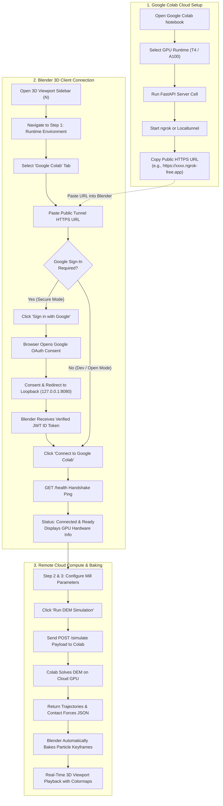
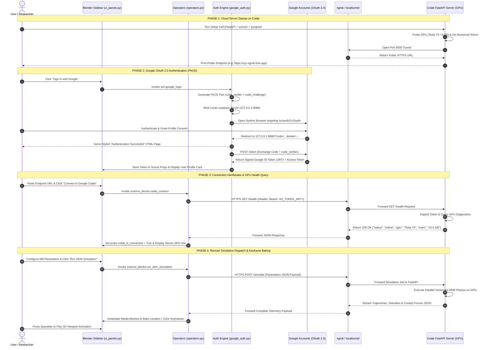

# Google Colab Remote GPU Integration Guide

This guide explains the architecture, security protocol, source code mapping, and step-by-step workflow for connecting **Science Blocks** in Blender to a remote **Google Colab GPU server**. This allows you to offload intensive Discrete Element Method (DEM) particle physics, large media charges, and multiphysics simulations to high-performance cloud GPUs (NVIDIA Tesla T4, V100, or A100) while visualizing the results locally in Blender in real time.

---

## 📂 Source Code Location & File Mapping

All logic governing the Google Colab connection, OAuth authentication, UI panels, and cloud simulation dispatch is organized across the following core source files in the `Science_Blocks/` codebase:

| Component / Subsystem | Primary Source File | Key Classes / Functions / Properties |
| :--- | :--- | :--- |
| **OAuth 2.0 PKCE Engine** | [`google_auth.py`](file:///c:/projects/reseach_project/Science_Blocks/google_auth.py) | `generate_pkce_pair()`, `OAuthCallbackHandler`, `run_auth_server()`, `finish_authentication_flow()` |
| **Google Auth Operators** | [`google_auth.py`](file:///c:/projects/reseach_project/Science_Blocks/google_auth.py) | `SCIENCE_BLOCKS_OT_google_login`, `SCIENCE_BLOCKS_OT_google_logout`, `SCIENCE_BLOCKS_OT_google_copy_token` |
| **Google Auth UI Card** | [`google_auth.py`](file:///c:/projects/reseach_project/Science_Blocks/google_auth.py) | `draw_google_auth_card()`, `VIEW3D_PT_google_auth_panel` |
| **Colab Connection Operators** | [`operators.py`](file:///c:/projects/reseach_project/Science_Blocks/operators.py#L389-L473) | `SCIENCE_BLOCKS_OT_colab_connect`, `SCIENCE_BLOCKS_OT_colab_disconnect` |
| **Colab State Properties** | [`properties.py`](file:///c:/projects/reseach_project/Science_Blocks/properties.py#L261-L318) | `python_environment_type`, `colab_endpoint_url`, `colab_is_connected`, `colab_status_msg`, `colab_server_info` |
| **Step 1 Runtime Panel** | [`ui_panels.py`](file:///c:/projects/reseach_project/Science_Blocks/ui_panels.py#L86-L113) | `draw_step_1_python_env()` (`elif env_type == "COLAB":`) |
| **Local / Cloud DEM Solver** | [`dem_solver.py`](file:///c:/projects/reseach_project/Science_Blocks/dem_solver.py#L226-L665) | `solve_planetary_dem()`, `instantiate_dem_particles_in_blender()` |

---

## 🏗️ System Architecture & Workflow

The integration operates across a secure client-server bridge:

```
┌────────────────────────────────────────────────────────────────┐
│                     LOCAL CLIENT (BLENDER)                     │
│                                                                │
│  1. Configure Planetary Mill & Charge                          │
│     • File: properties.py (ScienceBlocksProperties)            │
│  2. Google OAuth 2.0 (PKCE) Sign-In                            │
│     • File: google_auth.py (SCIENCE_BLOCKS_OT_google_login)    │
│  3. Enter Public HTTPS Tunnel URL                              │
│     • File: ui_panels.py (props.colab_endpoint_url)            │
│  4. Handshake & Health Query (/health)                         │
│     • File: operators.py (SCIENCE_BLOCKS_OT_colab_connect)     │
└───────────────────────────────┬────────────────────────────────┘
                                │
                                │ 1. HTTPS GET /health (Header: Bearer <ID_TOKEN>)
                                ├──────────────────────────────────────────────────────────┐
                                │ 2. Return GPU Hardware Info & Active Engines             │
                                │                                                          │
                                │ 3. HTTPS POST /simulate (Mill Params & Particles JSON)   │
                                ├──────────────────────────────────────────────────────────┤
                                │ 4. Compute High-Performance DEM & Stream Trajectories    │
                                │                                                          │
                                ▼                                                          │
┌────────────────────────────────────────────────────────────────┐                         │
│                  SECURE REVERSE PROXY TUNNEL                   │                         │
│               (ngrok / localtunnel / Cloudflare)               │                         │
└───────────────────────────────┬────────────────────────────────┘                         │
                                │                                                          │
                                ▼                                                          │
┌────────────────────────────────────────────────────────────────┐                         │
│                      REMOTE CLOUD (COLAB)                      │                         │
│                                                                │                         │
│  • Cloud GPU Hardware: NVIDIA T4 / V100 / A100                 │                         │
│  • Application Server: FastAPI + Uvicorn HTTP Server           │                         │
│  • Solver Logic: dem_solver.py (vectorized on cloud NumPy/GPU) │─────────────────────────┘
```

---

## 🔄 User Connection Flow (Step-by-Step Flowchart)

The following flowchart illustrates the step-by-step path the user follows to connect Blender to Google Colab:



---

## ⏱️ Detailed Connection & Simulation Sequence Diagram

The following sequence diagram details the exact asynchronous message exchange and cryptographic verification between the user, Blender subsystems, Google OAuth servers, the public tunnel, and the remote Google Colab GPU backend:



---

## 🤔 "Should the User...?" — Technical Decision Matrix

| Question | Recommendation | Technical Rationale & Implementation Details |
| :--- | :--- | :--- |
| **Should the user create their own Google Cloud Client ID?** | **Optional** (Default works via PKCE) | RFC 7636 (PKCE) is designed specifically for native desktop applications without requiring a client secret. Science Blocks includes a default desktop client configuration. However, if your research lab requires corporate domain restrictions (`@university.edu`), you can toggle **Credentials Settings** in [`google_auth.py`](file:///c:/projects/reseach_project/Science_Blocks/google_auth.py#L557) and enter your own Google Cloud Console OAuth 2.0 Client ID. |
| **Should the user use ngrok or localtunnel?** | **ngrok** for production; **localtunnel** for quick testing | **ngrok** provides high bandwidth, low latency, and robust HTTPS stability; it requires a free auth token from `ngrok.com`. **Localtunnel** (`!lt --port 8000`) requires zero registration and is instant, but may occasionally experience public rate limits. |
| **Should the Colab notebook tab remain open?** | **Yes** (Keep active during simulation) | Free Google Colab virtual machines automatically terminate background processes after 15–30 minutes of idle disconnection if the browser tab is closed. Keep the Colab tab open in your browser while your simulation runs. |
| **Should the Google ID token be refreshed?** | **Automatically handled** | Google ID Tokens (JWT) expire after 1 hour. If an `HTTP 401: Authentication Required` error is displayed in Blender, simply click **Sign in with Google** once in the sidebar to retrieve a fresh token. |
| **Should the user choose Colab or Local Blender runtime?** | **Colab** for large charges / parameter sweeps; **Local** for quick CAD checks | Use **Blender Bundled Python** for quick geometric verification (10–30 balls, <100 frames). Switch to **Google Colab** when simulating large charges (50–500 balls, >300 frames) or running coupled multiphysics to avoid freezing your local workstation. |

---

## 🔐 Security & Google OAuth 2.0 PKCE Authentication

* **Source File**: [`google_auth.py`](file:///c:/projects/reseach_project/Science_Blocks/google_auth.py)

To ensure that only authorized users can dispatch compute jobs to your cloud server, Science Blocks implements **RFC 8252** (OAuth 2.0 for Native Apps) and **RFC 7636** (Proof Key for Code Exchange - PKCE):

1. **Local Loopback Redirect** (`google_auth.py` lines 28–63):
   * When you click **Sign in with Google** (`SCIENCE_BLOCKS_OT_google_login`), Science Blocks starts a temporary, local HTTP server (`run_auth_server()`) listening on an open port on `127.0.0.1` (default: 8080).
   * It generates a cryptographically random 64-byte `code_verifier` and computes its SHA-256 `code_challenge` via `generate_pkce_pair()`.
2. **Browser Authentication** (`google_auth.py` lines 415–465):
   * Blender launches your system's default browser targeting `https://accounts.google.com/o/oauth2/v2/auth` with Google's OAuth consent screen.
   * After signing in, Google redirects back to `http://127.0.0.1:8080/?code=...&state=...`.
3. **Cryptographic Token Exchange** (`google_auth.py` lines 242–336):
   * `OAuthCallbackHandler` captures the authorization code, validates the anti-CSRF state token, and serves a clean confirmation page.
   * The background worker `finish_authentication_flow()` sends a backchannel POST request to `https://oauth2.googleapis.com/token` to exchange the code and `code_verifier` for a signed **Google ID Token (JWT)** and Access Token.
4. **Authorized Cloud Communication** (`operators.py` lines 407–410):
   * Blender automatically attaches your JWT ID Token to every request sent to the Colab server:
     ```http
     Authorization: Bearer <GOOGLE_ID_TOKEN_JWT>
     ```
   * The Colab FastAPI server verifies this token against Google's public certificates (`https://www.googleapis.com/oauth2/v3/certs`) to verify your identity before executing compute tasks.

---

## 🚀 Step-by-Step Setup Guide

### Step 1: Launch the FastAPI Server in Google Colab

1. Open [Google Colab](https://colab.research.google.com/) and create a new notebook.
2. In the Colab menu, select **Runtime > Change runtime type**, select **T4 GPU** (or A100 if available), and click **Save**.
3. Copy and run the following script in a code cell:

```python
# =============================================================================
# SCIENCE BLOCKS — Google Colab FastAPI Server (Zero Signup / Auto-Tunnel)
# Mirrors: dem_solver.py and operators.py for cloud GPU execution
# =============================================================================

# 1. Free port 8000 if previously occupied (prevents Errno 98: Address already in use)
!fuser -k 8000/tcp 2>/dev/null || true

# 2. Install Dependencies
!pip install -q fastapi uvicorn pyngrok pydantic numpy scipy

import os
import sys
import json
import math
import time
import re
import subprocess
import threading
import numpy as np
from typing import Dict, Any, Optional
from pydantic import BaseModel
from fastapi import FastAPI, Header, HTTPException, Depends
from fastapi.middleware.cors import CORSMiddleware
import uvicorn

# OPTIONAL: If you want to use ngrok, paste your token below.
# If left empty, it will automatically use free Cloudflare Tunnel with ZERO signup/account needed!
NGROK_AUTH_TOKEN = ""

# 3. Initialize FastAPI Application
app = FastAPI(title="Science Blocks Colab DEM Engine", version="1.0.0")

app.add_middleware(
    CORSMiddleware,
    allow_origins=["*"],
    allow_credentials=True,
    allow_methods=["*"],
    allow_headers=["*"],
)

# 3. GPU Hardware Diagnostics
def get_gpu_info() -> str:
    try:
        import torch
        if torch.cuda.is_available():
            name = torch.cuda.get_device_name(0)
            mem = torch.cuda.get_device_properties(0).total_memory / (1024**3)
            return f"{name} ({mem:.1f} GB VRAM)"
    except Exception:
        pass
    return "Standard Cloud CPU (No GPU Active)"

# 4. Simulation Payload Schema (mirrors properties.py ScienceBlocksProperties)
class SimulationRequest(BaseModel):
    sun_rpm: float = 200.0
    jar_rpm: float = -300.0
    r_sun: float = 1.30
    r_jar: float = 0.45
    h_jar: float = 1.10
    ball_count: int = 25
    ball_radius_m: float = 0.012
    ball_density: float = 7850.0
    youngs_modulus_gpa: float = 210.0
    poissons_ratio: float = 0.30
    restitution: float = 0.82
    static_friction: float = 0.20
    rolling_friction: float = 0.05
    frames: int = 150
    fps: float = 30.0
    substeps_per_frame: int = 40
    contact_model: str = "HERTZ_MINDLIN"
    charge_distribution: str = "MONODISPERSE"
    integrator: str = "VELOCITY_VERLET"
    gravity: float = 9.81
    mill_orientation: str = "VERTICAL"
    slurry_drag: bool = False
    slurry_viscosity: float = 0.001
    slurry_density: float = 1000.0

# 5. Core Numerical DEM Solver (Mirrors dem_solver.py solve_planetary_dem)
def run_cloud_dem(req: SimulationRequest) -> Dict[str, Any]:
    np.random.seed(42)
    dt_frame = 1.0 / max(1.0, req.fps)
    dt = dt_frame / max(1, req.substeps_per_frame)
    omega_sun = (req.sun_rpm * 2.0 * math.pi) / 60.0
    omega_jar = (req.jar_rpm * 2.0 * math.pi) / 60.0

    # Charge Generation
    radii = np.full(req.ball_count, req.ball_radius_m, dtype=np.float64)
    volumes = (4.0 / 3.0) * math.pi * (radii**3)
    masses = volumes * req.ball_density

    effective_wall_r = max(0.01, req.r_jar - req.ball_radius_m)
    half_h = max(0.01, (req.h_jar / 2.0) - req.ball_radius_m)

    angles = np.random.uniform(0, 2 * math.pi, req.ball_count)
    r_pos = np.random.uniform(0, effective_wall_r * 0.70, req.ball_count)
    pos = np.column_stack((r_pos * np.cos(angles), r_pos * np.sin(angles), np.random.uniform(-half_h*0.5, half_h*0.5, req.ball_count)))
    vel = np.zeros_like(pos)

    trajectories = np.zeros((req.frames, req.ball_count, 3), dtype=np.float32)
    velocities = np.zeros((req.frames, req.ball_count, 3), dtype=np.float32)
    forces = np.zeros((req.frames, req.ball_count), dtype=np.float32)

    total_impacts = 0
    impact_energies = []
    current_time = 0.0

    for f in range(req.frames):
        trajectories[f, :, :] = pos.astype(np.float32)
        velocities[f, :, :] = vel.astype(np.float32)
        frame_forces = np.zeros(req.ball_count, dtype=np.float32)

        for _ in range(req.substeps_per_frame):
            # Centrifugal and Coriolis Accelerations
            a_sun_x = (omega_sun**2) * req.r_sun * math.cos(omega_jar * current_time)
            a_sun_y = -(omega_sun**2) * req.r_sun * math.sin(omega_jar * current_time)
            a_jar_x = (omega_jar**2) * pos[:, 0]
            a_jar_y = (omega_jar**2) * pos[:, 1]
            omega_eff = omega_jar + omega_sun
            a_cor_x = 2.0 * omega_eff * vel[:, 1]
            a_cor_y = -2.0 * omega_eff * vel[:, 0]

            acc = np.zeros_like(pos)
            acc[:, 0] = a_sun_x + a_jar_x + a_cor_x
            acc[:, 1] = a_sun_y + a_jar_y + a_cor_y
            acc[:, 2] = -req.gravity if req.mill_orientation == "VERTICAL" else 0.0

            # Symplectic Velocity-Verlet
            pos += vel * dt + 0.5 * acc * (dt**2)
            current_time += dt

            # Wall Collisions
            rad_dist = np.sqrt(pos[:, 0]**2 + pos[:, 1]**2)
            wall_hit = rad_dist > (req.r_jar - req.ball_radius_m)
            if np.any(wall_hit):
                for idx in np.where(wall_hit)[0]:
                    nx = pos[idx, 0] / max(1e-6, rad_dist[idx])
                    ny = pos[idx, 1] / max(1e-6, rad_dist[idx])
                    overlap = rad_dist[idx] - (req.r_jar - radii[idx])
                    pos[idx, 0] -= nx * overlap
                    pos[idx, 1] -= ny * overlap
                    vn = vel[idx, 0] * nx + vel[idx, 1] * ny
                    if vn > 0:
                        total_impacts += 1
                        fn = masses[idx] * (1.0 + req.restitution) * vn / dt
                        frame_forces[idx] = max(frame_forces[idx], float(fn))
                        vel[idx, 0] -= (1.0 + req.restitution) * vn * nx
                        vel[idx, 1] -= (1.0 + req.restitution) * vn * ny
                        impact_energies.append(float(0.5 * masses[idx] * (vn**2)))

            # Z bounds
            bot_hit = pos[:, 2] < -half_h
            if np.any(bot_hit):
                pos[bot_hit, 2] = -half_h
                vel[bot_hit, 2] *= -req.restitution
            top_hit = pos[:, 2] > half_h
            if np.any(top_hit):
                pos[top_hit, 2] = half_h
                vel[top_hit, 2] *= -req.restitution

            vel += acc * dt

        forces[f, :] = frame_forces

    return {
        "status": "success",
        "total_impacts": total_impacts,
        "mean_impact_energy_j": float(np.mean(impact_energies)) if impact_energies else 0.0,
        "max_impact_energy_j": float(np.max(impact_energies)) if impact_energies else 0.0,
        "trajectories": trajectories.tolist(),
        "velocities": velocities.tolist(),
        "forces": forces.tolist(),
    }

# 6. API Endpoints
@app.get("/health")
def health_check(authorization: Optional[str] = Header(None)):
    return {
        "status": "online",
        "gpu": get_gpu_info(),
        "message": "Science Blocks Colab GPU Backend Active",
        "authorized": bool(authorization and authorization.startswith("Bearer ")),
    }

@app.post("/simulate")
def simulate(req: SimulationRequest, authorization: Optional[str] = Header(None)):
    print(f"Executing cloud DEM for {req.ball_count} balls over {req.frames} frames...")
    return run_cloud_dem(req)

# 7. Start Uvicorn Server in Background
threading.Thread(target=lambda: uvicorn.run(app, host="0.0.0.0", port=8000, log_level="warning"), daemon=True).start()
time.sleep(2)

# 8. Start Public Tunnel (Cloudflare or ngrok)
public_url = None
if NGROK_AUTH_TOKEN.strip():
    from pyngrok import ngrok
    ngrok.set_auth_token(NGROK_AUTH_TOKEN.strip())
    public_tunnel = ngrok.connect(8000)
    public_url = public_tunnel.public_url
else:
    # Use Cloudflare Tunnel (Zero signup, completely free HTTPS tunnel)
    if not os.path.exists("cloudflared"):
        print("⬇️ Downloading Cloudflare Tunnel (No signup required)...")
        subprocess.run(["wget", "-q", "-nc", "https://github.com/cloudflare/cloudflared/releases/latest/download/cloudflared-linux-amd64", "-O", "cloudflared"])
        subprocess.run(["chmod", "+x", "cloudflared"])
    
    proc = subprocess.Popen(["./cloudflared", "tunnel", "--url", "http://127.0.0.1:8000"],
                            stdout=subprocess.PIPE, stderr=subprocess.STDOUT, text=True)
    for line in iter(proc.stdout.readline, ''):
        match = re.search(r'https://[a-zA-Z0-9-]+\.trycloudflare\.com', line)
        if match:
            public_url = match.group(0)
            break

print("\n" + "=" * 70)
print("🚀 SCIENCE BLOCKS COLAB GPU BACKEND IS RUNNING!")
print(f"Public Colab Endpoint URL: {public_url}")
print("Copy and paste this URL into Blender > Sidebar > Science Blocks > Step 1")
print("=" * 70 + "\n")
```

---

### Step 2: Alternative Free Tunneling via Localtunnel (No Token Required)

If you don't have an ngrok account, you can expose the Colab port using **Localtunnel**:

```bash
# In a Colab notebook cell:
!npm install -g localtunnel
!curl -s https://loca.lt/mytunnelpassword # Copy password if prompted by browser
!lt --port 8000
```
This generates a URL like `https://funny-tiger-42.loca.lt`.

---

### Step 3: Connect from Blender

* **UI Source Code**: [`ui_panels.py`](file:///c:/projects/reseach_project/Science_Blocks/ui_panels.py#L86-L113) (`draw_step_1_python_env`)
* **Operator Source Code**: [`operators.py`](file:///c:/projects/reseach_project/Science_Blocks/operators.py#L389-L456) (`SCIENCE_BLOCKS_OT_colab_connect`)

1. Open Blender and navigate to the **Science Blocks** tab in the 3D Viewport sidebar (<kbd>N</kbd>).
2. In **Step 1: Compute Runtime Environment**, select the **Google Colab** tab (`props.python_environment_type = "COLAB"` in [`properties.py`](file:///c:/projects/reseach_project/Science_Blocks/properties.py#L261)).
3. In the **Colab URL** field (`props.colab_endpoint_url`), paste your public tunnel URL (e.g. `https://xxxx.ngrok-free.app` or `https://xxxx.loca.lt`).
4. Click **Connect to Google Colab** (triggers operator `science_blocks.colab_connect` in [`operators.py`](file:///c:/projects/reseach_project/Science_Blocks/operators.py#L389)):
   * Science Blocks sends an asynchronous health ping to `https://your-url/health`.
   * When connected, the status displays **Connected & Ready** (`props.colab_is_connected = True`) along with the remote GPU model (`props.colab_server_info`, e.g. `Tesla T4 (15.0 GB VRAM)`).
5. Under the **Google Account Hub** card (drawn by `draw_google_auth_card` in [`google_auth.py`](file:///c:/projects/reseach_project/Science_Blocks/google_auth.py#L527)):
   * Click **Sign in with Google** to complete OAuth authentication in your browser.
   * Once authenticated, your verified Google account is linked to the session and your JWT token is automatically passed with simulation requests.

---

### Step 4: Run High-Speed Simulation on Colab

* **Baking Source Code**: [`dem_solver.py`](file:///c:/projects/reseach_project/Science_Blocks/dem_solver.py#L528-L665) (`instantiate_dem_particles_in_blender`)
* **Dispatch Source Code**: [`operators.py`](file:///c:/projects/reseach_project/Science_Blocks/operators.py#L692-L833) (`SCIENCE_BLOCKS_OT_run_dem_simulation`)

1. Move to **Step 2: 3D Models & Kinematics** and select or generate your planetary mill rig.
2. In **Step 3: DEM Particle Physics & Telemetry**:
   * Set your particle count (e.g., 50–200 balls).
   * Set your frames (e.g., 300 frames).
   * Choose **Colormap**: `Speed / Velocity Magnitude` or `Contact Force / Impact Load`.
   * Click **Run DEM Simulation (Bake Physics)**.
3. Science Blocks dispatches the payload to your Google Colab GPU server.
4. When computation finishes, Colab streams back the keyframes. Science Blocks automatically bakes the trajectories and dynamic velocity/force color animations directly into your Blender scene via `instantiate_dem_particles_in_blender()` in [`dem_solver.py`](file:///c:/projects/reseach_project/Science_Blocks/dem_solver.py#L528)!
5. Press <kbd>Spacebar</kbd> to inspect the high-frame-rate particle collisions inside the rotating jar.

---

## 🛠️ Troubleshooting & Frequently Asked Questions

### 1. "Connection Failed: Connection Refused or Timeout"
* **Source Check**: In [`operators.py`](file:///c:/projects/reseach_project/Science_Blocks/operators.py#L413-L422), `SCIENCE_BLOCKS_OT_colab_connect` pings `/health` with an 8-second timeout.
* **Check Tunnel URL**: Ensure you copied the full HTTPS URL including `https://` and without trailing slashes.
* **Confirm Colab Runtime**: In Google Colab, verify that the code cell is still running and hasn't timed out.
* **ngrok Free Tier Warning**: The first time you visit an ngrok URL in a browser, ngrok displays a brief warning interstitial page. Clicking "Visit Site" once in your browser clears this for your IP address.

### 2. "HTTP 401: Authentication Required"
* **Source Check**: Handled in [`operators.py`](file:///c:/projects/reseach_project/Science_Blocks/operators.py#L436-L439) when receiving an HTTP 401 or 403 challenge.
* Your Colab server requires a valid Google ID token.
* Click **Sign in with Google** in Blender's Colab Account Hub (`google_auth.py`) to obtain an active token.

### 3. "Errno 98: error while attempting to bind on address ('0.0.0.0', 8000): address already in use"
* **Why it happens**: When you re-run a cell in Google Colab, the Uvicorn server started during the previous run is still listening on port 8000 in a background daemon thread.
* **Solution**: Kill the previous server on port 8000 before starting Uvicorn by adding this line at the very top of your Colab cell:
  ```python
  !fuser -k 8000/tcp 2>/dev/null || true
  ```
  *(This is already included by default in the script copied from Blender).*

### 4. "PyngrokNgrokError: ERR_NGROK_4018: This ngrok session is not authenticated"
* **Why it happens**: ngrok now mandates an active account and authentication token for all tunnel sessions. An unauthenticated `ngrok.connect()` will raise error `ERR_NGROK_4018`.
* **Solution A (Recommended — Zero Signup / Free Cloudflare Tunnel)**:
  Leave `NGROK_AUTH_TOKEN = ""` empty. The script will automatically download **Cloudflare Tunnel (`cloudflared`)** and provide a free, instant `https://*.trycloudflare.com` URL with **no accounts, tokens, or credit cards required**.
* **Solution B (If using ngrok)**:
  Sign up for a free account at [ngrok.com](https://dashboard.ngrok.com/signup) and copy your authtoken from [ngrok dashboard](https://dashboard.ngrok.com/get-started/your-authtoken). Paste it into:
  ```python
  NGROK_AUTH_TOKEN = "your_actual_token_here"
  ```

### 5. Colab Notebook Disconnection / Idle Timeout
* Free Google Colab instances automatically disconnect if left idle without user interaction for ~90 minutes.
* Keep the Colab browser tab open while running long simulation experiments.
